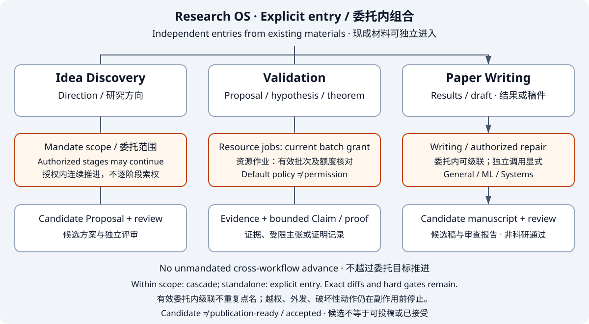

<div align="center">
  <picture>
    <source media="(prefers-color-scheme: dark)" srcset="docs/assets/logo-ondark.png">
    <source media="(prefers-color-scheme: light)" srcset="docs/assets/logo-onlight.png">
    
  </picture>

  <p>面向科研工作流的 Agent Skills 套件</p>

  <p>
    <a href="https://opensource.org/licenses/MIT"></a>
    <a href="https://linux.do"></a>
    <a href="skills/README.md"></a>
    <a href="docs/user-acceptance-guide.md"></a>
    <a href="https://github.com/toRolex/Research-OS-Studio/stargazers"></a>
  </p>

  <p>
    <a href="#english-version">English</a> · <a href="#research-os-studio">中文说明</a>
  </p>
</div>

> **Breaking（v2）**：旧只读入口 `ask-research-os` 已删除，没有双轨期。不确定从哪开始时，用 `/research-os` 的 route-only（例如 `/research-os 我该从哪开始`）。它只给推荐，不启动任务、不联网、不写文件。

---

## 架构与工作流

<div align="center">
  
</div>

---

## English Version

Research OS Studio is an Agent Skills suite designed for research workflows. It integrates into your research workspace, breaking work into clear stages: idea discovery, experimental validation, and paper writing. The AI assists within explicit authorization boundaries, keeping key judgments and final decisions with the researcher.

[View full English documentation →](docs/README-en.md)

---

## Research OS Studio

Research OS Studio 将科研过程拆解为边界明确的工作流。AI 在单次授权范围内生成候选方案、代码与草稿，实验设计、结果验收与推进决策由你把控。

## 目录

- [核心设计原则](#核心设计原则)
- [快速开始](#快速开始)
- [典型科研流程](#典型科研流程)
- [Skill 能力清单](#skill-能力清单)
- [安全与控制原则](#安全与控制原则)
- [常见问题](#常见问题)
- [相关文档](#相关文档)
- [开源协议](#开源协议)

---

## 核心设计原则

- **纯 Agent Skills**：无需安装独立 CLI、Python 包或后台服务，安装即用。
- **三类科研能力地图（不是固定阶段顺序）**：
  1. **Idea Cycle（构思与查新）**：文献检索、多视角构思、新颖性核查、独立评审与方案收敛。
  2. **Validation Cycle（实验与理论验证）**：实证路径管理实验计划、执行监控、统计分析与审计；理论路径负责推导记录、证明起草、审查与修复。
  3. **Writing Cycle（论文写作与打磨）**：正文起草、学术绘图、LaTeX 编译检查、引用与结论一致性审计、审稿回复及转投适配。
- **研究委托与硬门**：一次入口请求形成有界委托（研究目标、授权范围与额度、完成条件）；入口可据此组合和重排能力，不因普通阶段转换、输出路径或每轮修复重复请求批准。用户要求只读时保持只读；替换主要目标须等目标所有者确认，超出授权或额度、对外发送、破坏性操作及具体能力声明的硬门仍须停下并只阻塞相关工作。缺少 setup 或明确预算时可以有界开始，不把缺失预算当作资源授权。只有宿主确实提供子代理能力时才派发；不支持时只做当前环境可完成的部分，并如实报告未执行的委托工作。
- **原生文件格式**：成果直接以 Markdown、LaTeX、脚本和数据文件交付。

---

## 快速开始

### 1. 安装 Skills

在科研项目根目录下执行：

```bash
# 查看所有可用技能
npx skills@latest add toRolex/Research-OS-Studio --list

# 安装全部技能到当前项目
npx skills@latest add toRolex/Research-OS-Studio --all

# 仅用 Research OS Discovery 时，同时安装入口和五项 Required 能力
npx skills@latest add toRolex/Research-OS-Studio --skill research-os research-lit idea-generation novelty-check idea-review idea-refinement --agent codex --copy -y
```

### 2. 可选：初始化工作区

安装后可运行初始化命令；它不是开始研究的前置条件。缺少 setup 或明确预算时，`/research-os` 仍可在当前能力与授权允许范围内有界开始，不擅自消耗未授权资源。以下 `/name` 示例是逻辑点名；pi 原生命令为 `/skill:name`（setup：`/skill:setup-research-os`；入口：`/skill:research-os 我该从哪开始`），Claude Code 用 `/name`，Codex 用 `$name` 或明确点名已安装技能。pi 的普通 `/name` 文本不保证加载隐藏的显式 Skill：

```bash
/setup-research-os
```

该命令会检查现有目录结构并提供配置建议。所有改动在写入前都会展示完整草稿供你确认，不会覆盖已有研究资料，也不会擅自安装系统环境。

### 3. 选择技能

如果你不确定从哪里切入，直接问统一入口，并说明只要推荐：

```bash
/research-os 我该从哪开始
```

这进入 route-only：按研究方向或已有材料给推荐，不修改文件、不联网，也不自动执行推荐任务。旧入口 `ask-research-os` 已删除。目标明确时，可直接点名底层技能，或让 `/research-os` 按研究委托组合能力。委托给出目标、授权范围、可用资源额度与完成条件；普通能力/阶段转换不逐次停下请批。没有 setup 或明确预算时可先做有界且不越权的工作；需要消耗运行资源的步骤只在有效额度内执行，缺少或超出额度时停在该分支。一次文献综合可直接按委托交付并验收实际产物。`experiment-bridge` 是 `/research-os` 的需求配方名，不是兼容 Skill；实验执行唯一进入 `run-experiment`，分析与审计仍由独立能力承担。运行资源须有研究日志里的本批授权；setup 中的默认政策不是运行许可。外发、破坏性操作、越权或超额度，以及能力定义的硬门，仍须在相应副作用前停止。

已有上一轮证明、改进日志或研究作业记录时，不要从零重跑：

- `/research-os` proof：续接固定命题，新目录只做本轮 obligation。
- `/research-os` improvement：在确认的轮数和写入范围内做 review → repair → re-review。
- `/research-os` pickup：新会话重读交接、算力政策和研究日志。已过期的授权保持过期。

---

## 典型科研流程

以下是按常见目标组织的参考配方，不是必须依次通过的阶段或固定流水线。统一入口依照研究委托在能力间组合、重排与回访；完成条件满足后再收束。

### 1. 构思与立项（Idea Discovery）
```text
输入研究方向
      ↓
/research-os 我有方向，没有 idea
      ↓
research-os Discovery 配方
  按目标缺口选择必要能力，可局部开始、重排与回访
  ├─ 文献范围不足：research-lit
  ├─ 候选不足：idea-generation（必要时 creative-thinking）
  ├─ prior work 未核：novelty-check
  ├─ 需独立挑战：idea-review
  └─ 需收敛或 Proposal：idea-refinement
      ↓
按本次目标交付局部报告和/或 Proposal 后停止
```

全链 Discovery 是适用时的参考配方，不是每次必经阶段。已有成果可满足或省略对应职责；新增证据可触发重排与回访。目标替换、越权、超额或既有文件冲突只阻塞对应分支。

### 2. 实验与推导（Validation）
```text
固定研究假设或待证命题
      ↓
实证路线                             理论路线
/experiment-plan                    formula-derivation（公式推导）
      ↓                                   ↓
/run-experiment                     proof-writer（起草证明）
  ├─ 代码试跑与资源监控                   ↓
  ├─ 训练异常诊断与干预建议          proof-review（逻辑与反例审查）
  └─ 独立审计代码与结果真实性             ↓
      ↓                             /proof-repair（有界修复）
/result-to-claim（提取约束结论）          ↓
      ↓                             /research-os proof 配方（按需使用 proof-review 方法资源）
交付实验审计与 Claim 报告（停止）    交付完整证明记录（停止）
```

理论分支由证据决定具体活动，可在推导、证明构造、fresh 只读审查、finding 修复和形式化之间切换；这些不是每次必经的固定阶段，长期任务的轮次与额度只由 `/research-os` 委托管理。

### 3. 论文写作与审计（Writing Cycle）
```text
输入实验数据或理论成果
      ↓
/research-os 将写作请求统一路由到 paper-writing
  ├─ 通用写作：general
  ├─ ML：按需读取 ML/AI 专业标准
  └─ Systems：按需读取 Systems 专业标准
      ↓
按委托范围规划、绘图、起草、真实编译
并列审查：paper-claim-audit、citation-audit、claim-stress-test
证明稿件才读 proof-review
      ↓
交付候选稿与审查报告
投稿、上传不在写作路线
委托内已授权的编译与引用修复继承该授权
      ↓
投后管理与衍生（/research-os 编排；叶入口仍可点名）
  ├─ 审稿回复：/research-os 回复审稿 → rebuttal
  ├─ 转投适配：/research-os 转投 → resubmit
  └─ 学术演讲：/research-os 做会议演讲 → paper-talk
      ↓
交付候选回复、新目录投稿材料或 slides/notes/script
有效委托内按裁决规则继续；目标替换、越权及外发等真实边界仍停
```

---

## Skill 能力清单

本仓库提供可独立使用的技能，按触发机制分为两类：
- **除 setup 外全部显式调用**：用户直接点名，或父流程按路径级联读取全文。模型不因描述自动触发。
- **`setup-research-os`**：唯一允许模型主动建议的例外。它是可选初始化；被建议本身不是写入授权，写入前仍确认草稿及其中的角色映射。

| 分类 | 技能名称 | 调用方式 | 说明 |
|---|---|---|---|
| **General** | [setup-research-os](skills/general/setup-research-os/SKILL.md) | 可建议 | 可选的项目初始化：确认本 session 可用模型的角色映射、零授权默认政策与工作区种子；建议本身不是写入授权，也不是开始研究的前置条件 |
| | [research-os](skills/general/research-os/SKILL.md) | 显式 | 统一编排入口：一次调用是一份研究委托（目标/权限/额度/完成条件见 `references/mandate.md`）；只读走 route-only；仅在宿主具备真实子代理能力时委托。数学研究已迁入 proof 路线，旧长期证明控制器已删除；分支所需独立安装的 slug 与依赖见 [proof 配方](skills/general/research-os/playbooks/proof.md)，独立只读审查边界见[迁移说明](skills/general/research-os/references/migration-boundary.md) |
| | [swarm](skills/general/swarm/SKILL.md) | 显式 | 并行覆盖：分片、竞赛或混合探索，派发宿主真实子代理并汇总；独立 brief、输出隔离、缺证据有界重派，缺口不算通过（改编自 pstack swarm，MIT，见其 LICENSE） |
| | [interrogate](skills/general/interrogate/SKILL.md) | 显式 | 对抗审查：独立 reviewer 逐模型挑战研究材料或变更，findings 去重、分歧保留，主审四桶有据判断；始终只读，修复由委托按授权另行组织 |
| **Organization** | [arena](skills/organization/arena/SKILL.md) | 显式 | 候选比较与整合：同一任务并行独立候选，预先 rubric、交叉评判、主编排者逐项选基座并手工整合，数学整合后重查假设/记号/依赖闭合；胜出不等于原命题成立；已迁移到研究委托合同，缺子代理时标 blocked |
| **Idea Cycle** | [research-os Discovery 配方](skills/general/research-os/playbooks/discovery.md) | 通过 `/research-os` 路由 | 用户可直接给研究方向并要求完整 Proposal；按缺口选择、重排或回访五项 Required 能力，保留 fresh 独立评审 |
| | [research-lit](skills/idea-cycle/research-lit/SKILL.md) | 显式 | 文献检索与综合，标注出处与核实状态；已迁移到研究委托合同，不再有叶级审批门 |
| | [idea-generation](skills/idea-cycle/idea-generation/SKILL.md) | 显式 | 多视角生成研究候选方案，记录筛选理由 |
| | [creative-thinking-for-research](skills/idea-cycle/creative-thinking-for-research/SKILL.md) | 显式 | 构思瓶颈时的认知转换与正交发散 |
| | [novelty-check](skills/idea-cycle/novelty-check/SKILL.md) | 显式 | 检索已知工作，核对方案新颖性 |
| | [idea-review](skills/idea-cycle/idea-review/SKILL.md) | 显式 | 独立评审视角，指出方案弱点与潜在问题 |
| | [idea-refinement](skills/idea-cycle/idea-refinement/SKILL.md) | 显式 | 细化研究方案，输出最小可行路线与拓展路线 |
| **Validation** | [experiment-plan](skills/validation-cycle/experiment-plan/SKILL.md) | 显式 | 制定包含假设、基线、指标与预算的实验计划 |
| | [run-experiment](skills/validation-cycle/run-experiment/SKILL.md) | 显式 | 统一实验执行控制；记录输入版本、工具链、目录、作业身份、退出码、日志与产物 |
| | [experiment-queue](skills/validation-cycle/experiment-queue/SKILL.md) | 显式 | 管理批量实验队列与资源分配 |
| | [monitor-experiment](skills/validation-cycle/monitor-experiment/SKILL.md) | 显式 | 监控运行进程与状态，不做额外推论 |
| | [training-health-check](skills/validation-cycle/training-health-check/SKILL.md) | 显式 | 诊断 NaN、显存溢出、loss 停滞等训练异常 |
| | [analyze-results](skills/validation-cycle/analyze-results/SKILL.md) | 显式 | 统计分析实验结果与不确定性 |
| | [experiment-audit](skills/validation-cycle/experiment-audit/SKILL.md) | 显式 | 独立审计代码、评估逻辑与结果真实性 |
| | [result-to-claim](skills/validation-cycle/result-to-claim/SKILL.md) | 显式 | 根据实验证据收敛并提取科学结论 |
| | [formula-derivation](skills/validation-cycle/formula-derivation/SKILL.md) | 显式 | 推导数学公式，记录假设、步骤与误差界限 |
| | [proof-writer](skills/validation-cycle/proof-writer/SKILL.md) | 显式 | 起草数学证明，保留未完成的尝试与断点 |
| | [proof-review](skills/validation-cycle/proof-review/SKILL.md) | 显式 | 只读审查证明逻辑与边界反例，不修改文件 |
| | [proof-repair](skills/validation-cycle/proof-repair/SKILL.md) | 显式 | 在授权范围内有针对性地修复证明断点 |
| | [create-formal-verification-skill](skills/validation-cycle/create-formal-verification-skill/SKILL.md) | 显式 | 为项目建立可重跑的形式化检查；按问题选工具，记录假设/版本/同步并审计编码与原问题对应 |
| | [maintain-formal-verification-skill](skills/validation-cycle/maintain-formal-verification-skill/SKILL.md) | 显式 | 代码变化后把形式化检查重新对齐；重跑并区分验证漂移与代码 bug |
| | [create-verification-skill](skills/validation-cycle/create-verification-skill/SKILL.md) | 显式 | 为项目建立可运行的行为验证 Skill：启动、doctor、按用户路径驱动、证据与清理，播种特征覆盖映射；未执行的生成资产标草稿 |
| | [maintain-verification-skill](skills/validation-cycle/maintain-verification-skill/SKILL.md) | 显式 | 随应用变化维护行为验证 Skill：按特征源读与真实驱动，区分文档漂移与产品缺陷，交付已证明修正 |
| **Writing Cycle** | [paper-writing](skills/writing-cycle/paper-writing/SKILL.md) | 显式 | 统一写作入口：general／ML／Systems 标准；委托内编译与引用修复继承授权，不自动投稿 |
| | [paper-plan](skills/writing-cycle/paper-plan/SKILL.md) | 显式 | 规划论文大纲与 Claim-Evidence 证据对应矩阵 |
| | [paper-drafting](skills/writing-cycle/paper-drafting/SKILL.md) | 显式 | 依据实验数据与推导记录起草论文正文 |
| | [academic-plotting](skills/writing-cycle/academic-plotting/SKILL.md) | 显式 | 绘制学术图表并保留可复现绘图脚本 |
| | [paper-compile](skills/writing-cycle/paper-compile/SKILL.md) | 显式 | 调用本地 LaTeX 环境执行编译检查并报告警告 |
| | [paper-compile-repair](skills/writing-cycle/paper-compile-repair/SKILL.md) | 显式 | 精确 diff 修复 LaTeX 编译错误；委托内继承授权，不要求再次独立点名 |
| | [citation-audit](skills/writing-cycle/citation-audit/SKILL.md) | 显式 | 检查引用的准确性与上下文匹配度 |
| | [apply-citation-fixes](skills/writing-cycle/apply-citation-fixes/SKILL.md) | 显式 | 通过精确 diff 修复 BibTeX 条目或正文引用标记；委托已授权时继承范围 |
| | [paper-claim-audit](skills/writing-cycle/paper-claim-audit/SKILL.md) | 显式 | 校验正文数字、图表与原始实验数据的一致性 |
| | [claim-stress-test](skills/writing-cycle/claim-stress-test/SKILL.md) | 显式 | 模拟同行评审视角，针对论点薄弱处提出质疑 |
| | [research-improvement](skills/writing-cycle/research-improvement/SKILL.md) | 显式 | 对代码、论点或草稿进行有限轮次的评审与修改 |
| | [rebuttal](skills/writing-cycle/rebuttal/SKILL.md) | 显式 | 审稿回复叶入口；`/research-os` 的 rebuttal 路线按路径级联，不自动投稿或外发 |
| | [resubmit-pipeline](skills/writing-cycle/resubmit-pipeline/SKILL.md) | 显式 | 转投叶入口；resubmit 路线在新目录适配并保留旧稿，不自动投稿 |
| | [paper-talk](skills/writing-cycle/paper-talk/SKILL.md) | 显式 | 演讲叶入口；paper-talk 路线产出 slides、notes、script，不自动发布 |

---

## 安全与控制原则

1. **不修改系统环境**：不会擅自配置 Python、Lean、LaTeX、CUDA 驱动或云端凭证。依赖工具缺失时会明确提示。
2. **显式路线与副作用门**：用户显式调用才进入路线；授权内可逆步骤直接执行并事后呈现。越权、超额、破坏性与对外动作仍在执行前停下；叶 skill 只保留其真实副作用与独立调用边界。当前委托已授权的内部修复不要求再次点名。
3. **操作预先确认**：消耗大量算力、重写文件或调用付费 API 之前，会先声明范围并征求同意。

---

## 常见问题

**Q: 安装后会修改我现有的项目文件吗？**  
A: 不会。`setup-research-os` 初始化时会先扫描目录并展示拟修改内容，只有在你确认后才会写入。

**Q: 支持哪些 AI 客户端？**  
A: 支持遵循标准 Skills 机制的客户端，包括 Claude Code、Codex、Cursor、Gemini CLI、Kimi CLI、Pi 等。

---

## 相关文档

- [用户验收指南](docs/user-acceptance-guide.md)：测试用例与边界核验方法
- [产品地图与状态表](skills/general/research-os/references/PRODUCT-MAP.md)：技能定义与触发边界
- [Skills 目录总览](skills/README.md)：目录结构与兼容性说明
- [上游来源与许可证说明](docs/upstream-sources-and-licenses.md)：移植与借鉴项目的许可证声明

---

## 开源协议

本项目采用 [MIT 许可证](LICENSE)。各技能中引用的第三方来源说明见 [上游来源与许可证说明](docs/upstream-sources-and-licenses.md)。
